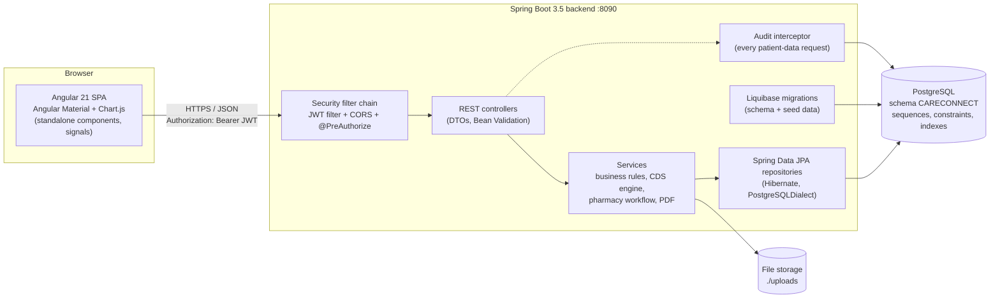
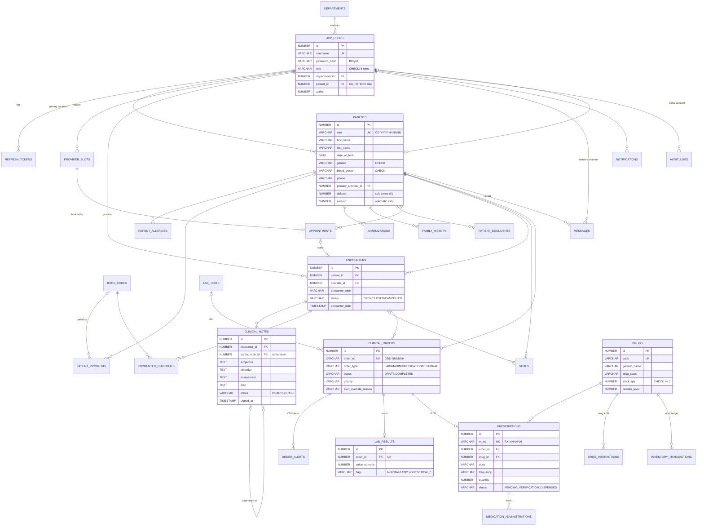
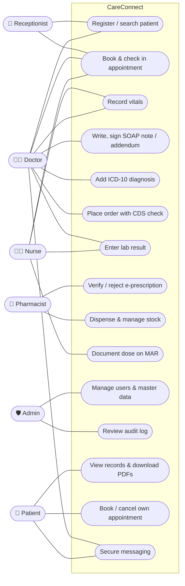
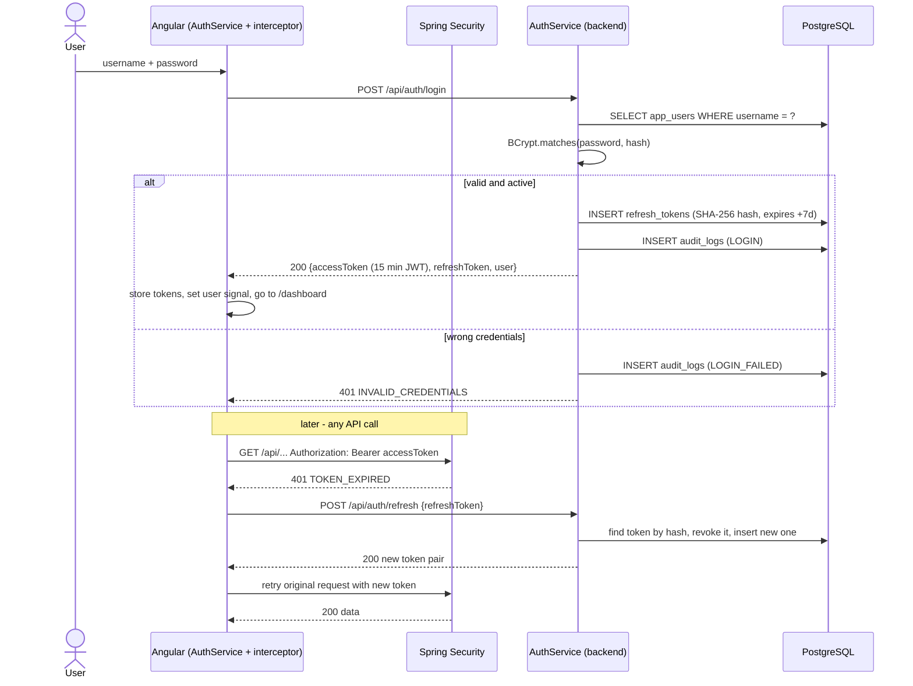
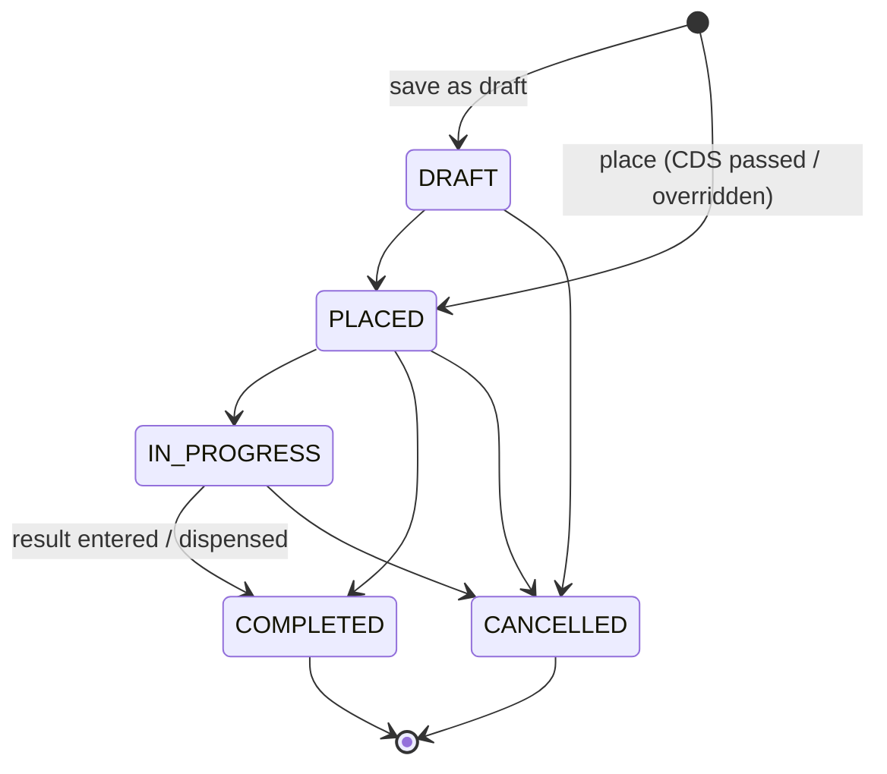
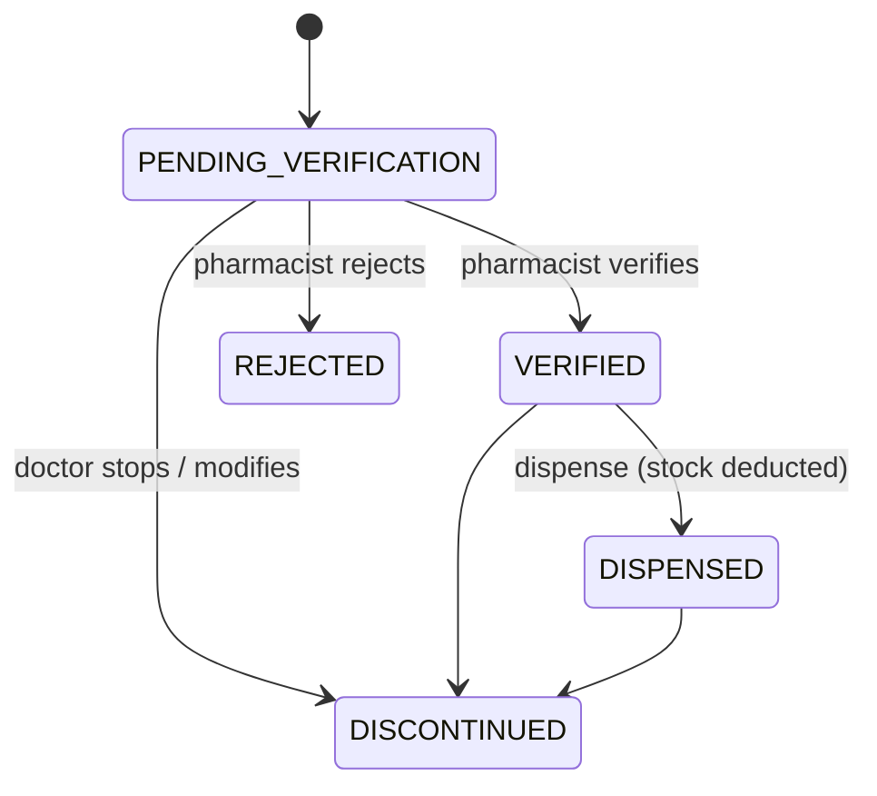

# CareConnect - Architecture and Design

This document holds the design diagrams for the project report. All diagrams use [Mermaid](https://mermaid.js.org/);
GitHub and VS Code (with a Mermaid extension) render them directly.

## 1. System architecture



**Layers (backend, package `com.careconnect.<module>`)**

| Layer | Package | Responsibility |
|---|---|---|
| Web | `web` | REST controllers, request validation, `@PreAuthorize` role checks, Swagger annotations |
| DTO / mapper | `dto`, `mapper` | Request/response records; MapStruct maps entities to DTOs so entities never leave the service layer |
| Service | `service` | Transactions and business rules (MRN generation, CDS checks, order lifecycle, stock deduction) |
| Repository | `repository` | Spring Data JPA queries (paging, sorting, soft-delete filters) |
| Model | `model` | JPA entities with `@Version` optimistic locking and created/updated audit columns |
| Cross-cutting | `common`, `security`, `config`, `audit` | Global exception handler, JWT, CORS, audit trail, OpenAPI |

Modules: `auth`, `user`, `patient`, `clinical`, `order`, `medication`, `scheduling`, `messaging`, `notification`, `portal`, `dashboard`, `audit`.

**Frontend structure (`frontend/src/app`)**

| Folder | Contents |
|---|---|
| `core/` | `AuthService` (tokens, user signal), `authInterceptor` (Bearer header + automatic refresh on 401), `authGuard` / `guestGuard`, typed `Api` client, models |
| `layout/` | Shell with role-based side menu, notification bell (polls every 30 s), user menu, change-password dialog |
| `shared/` | Confirm dialog, status chips, Chart.js wrapper, patient picker, ICD-10 picker, patient banner, vitals dialog |
| `pages/` | Landing, login, dashboard and one folder per module (patients, clinical, orders, pharmacy, nursing, scheduling, messages, admin, portal) |

## 2. Security design

- **Authentication**: `POST /api/auth/login` checks the BCrypt hash and returns a 15-minute **access token** (JWT, HS256, claims: user id, role, patient id) and a 7-day **refresh token**.
- **Refresh token rotation**: refresh tokens are random values stored only as SHA-256 hashes. Each refresh revokes the old token and issues a new pair. Re-using a revoked token revokes *all* of that user's tokens (theft detection).
- **Authorization**: every controller method has `@PreAuthorize` with a rule from `Authz` (minimum-necessary access). The Angular `authGuard` hides screens the role cannot use, but the server is the source of truth.
- **Patient isolation**: portal endpoints take the patient id from the token, never from the request, so a patient cannot read another record (404).
- **Audit**: `AuditInterceptor` writes one row per patient-data request (user, role, action, patient id, path, status, IP) and every login / failed login.
- **Other**: stateless sessions, CSRF disabled (no cookies), CORS limited to configured origins, secrets from environment variables, soft deletes, optimistic locking (`version`).

## 3. Entity-relationship diagram



Every table has its own sequence (`<table>_seq`); business numbers come from `mrn_seq`, `order_no_seq` and `rx_no_seq`.
All tables except code tables carry `created_at/created_by/updated_at/updated_by` and `version`. The full DDL is in
[`backend/src/main/resources/db/changelog/sql/001-schema.sql`](../backend/src/main/resources/db/changelog/sql/001-schema.sql).

## 4. Use-case diagram



## 5. Sequence diagrams

### 5.1 Login and token refresh



### 5.2 Medication order with drug-interaction check

```mermaid
sequenceDiagram
    actor D as Doctor
    participant UI as Order dialog (Angular)
    participant OC as OrderController
    participant OS as OrderService
    participant CDS as CdsService
    participant DB as PostgreSQL
    participant N as NotificationService

    D->>UI: choose drug (e.g. Aspirin for a patient on Warfarin)
    UI->>OC: POST /api/orders/check {patientId, drugId}
    OC->>CDS: evaluate(patient, drug)
    CDS->>DB: active allergies, active prescriptions, drug_interactions
    CDS-->>UI: alerts [DRUG_INTERACTION MAJOR -> CRITICAL, overridable]
    UI-->>D: show red alert + "override reason" box

    D->>UI: Place order (no reason yet)
    UI->>OC: POST /api/orders
    OC->>OS: create(request)
    OS->>CDS: evaluate again (server is authoritative)
    OS-->>UI: 409 CDS_ALERTS {details.alerts}
    D->>UI: enter override reason, Place order
    UI->>OC: POST /api/orders {..., overrideReason}
    OS->>DB: INSERT clinical_orders (order_no from order_no_seq, PLACED)
    OS->>DB: INSERT order_alerts (overridden = 1)
    OS->>DB: INSERT prescriptions (rx_no, PENDING_VERIFICATION)
    OS->>N: notify pharmacists ("Prescription awaiting verification")
    OS-->>UI: 201 OrderDetail
    Note over CDS: CONTRAINDICATED = hard stop (not overridable);<br/>allergy match = CRITICAL; duplicate therapy = WARNING
```

### 5.3 Pharmacist verification and dispensing

```mermaid
sequenceDiagram
    actor P as Pharmacist
    participant UI as Pharmacy queue (Angular)
    participant PC as PrescriptionController
    participant PS as PrescriptionService
    participant DB as PostgreSQL
    participant N as NotificationService

    P->>UI: open "To verify" tab
    UI->>PC: GET /api/prescriptions?status=PENDING_VERIFICATION
    P->>UI: select RX
    UI->>PC: GET /api/prescriptions/{id}
    PC-->>UI: prescription + CDS alerts + patient allergies + stock
    P->>UI: Verify (confirm dialog)
    UI->>PC: POST /api/prescriptions/{id}/verify {note}
    PS->>DB: status = VERIFIED, order -> IN_PROGRESS
    Note over PS,N: a rejection instead notifies the prescriber with the reason
    P->>UI: "To dispense" tab -> Dispense qty (confirm)
    UI->>PC: POST /api/prescriptions/{id}/dispense {quantity}
    PS->>DB: load drug (version column guards concurrent updates;<br/>CHECK stock_qty >= 0 in the table)
    alt enough stock
        PS->>DB: drugs.stock_qty -= qty
        PS->>DB: INSERT inventory_transactions (DISPENSE, balance)
        PS->>DB: prescription DISPENSED, order COMPLETED
        opt stock <= reorder level
            PS->>N: LOW_STOCK notification to pharmacists
        end
        PS-->>UI: 200 DISPENSED
    else insufficient stock
        PS-->>UI: 409 INSUFFICIENT_STOCK
    end
```

## 6. Order and prescription state machines




